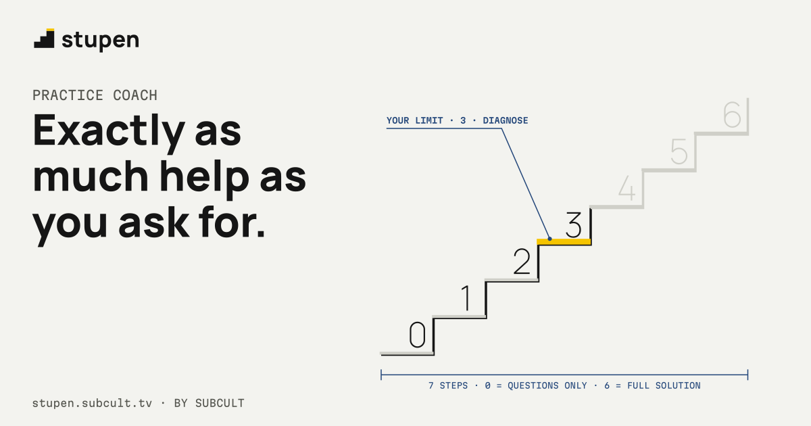

# Stupen



Stupen (ступень, a step; said STOO-pen) is a practice coach for anyone learning anything, at any level. You describe what you want to learn. The coach writes a plan sized to you, then builds hands-on lessons one at a time. Each lesson has exercises and tests that run in a sandbox. A chat coach helps as much or as little as you allow, on a help limit from 0, questions only, to 6, a full solution.

It is not released. SUBCULT runs it on its homelab for invited learners; the site is https://stupen.subcult.tv. Claude and ChatGPT run through their subscription command-line tools (`claude -p` and `codex exec`), not billed API keys.

## What it does

- **Tracks.** One per subject: a programming language, a topic such as SQL window functions, or something non-code such as Spanish verbs. Each track records your level (brand new to expert), goals, background, how you like to learn, session length and default help limit.
- **Plans.** The coach writes a learning plan, and can revise it on request ("go slower", "add a project") or adapt it to how your lessons went. Every earlier version is kept and can be restored.
- **Lessons.** Each lesson has a brief, starter files, tests and escalating hints, built from the plan, a topic you type, or your materials.
  - Before you see a lesson, the server runs its hidden reference solution against the tests in the sandbox. The reference must pass and the starter files must fail. If not, the generator gets one more try with the evidence. A lesson that still fails is kept and marked "tests unverified".
- **Practice formats.** Two kinds.
  - **Quick:** Python, TypeScript, JavaScript, Go, Rust, Java, C, C++, SQL (SQLite) and Bash, standard library only, in bubblewrap; checks start instantly.
  - **Container:** real projects in Docker with any packages. Presets: React + Vite, plain web page, Node, Python, Go, Rust, Java + Maven, Ruby, PHP + Composer, C# / .NET, Elixir, Deno and Bun. A custom environment can use any image with your own setup, install, check and preview commands, made in the app or added as a JSON file in `environments/` (repo or data folder). Learners can edit manifests to add packages and add their own files. Web environments get a live preview.
  - **Written answers:** for any subject; the coach grades them and records pass or revise.
  - **Your own check command:** for any other language installed on the server.
- **Materials.** Add links, uploads (PDF, Markdown, text, Word, ODT, EPUB, HTML, notebooks, code) or pasted text, or let the coach search the web for you. You can then:
  - build materials into the plan;
  - make a lesson from one or more of them;
  - attach one to a coach message.
- **Prompts.**
  - A library of buttons above the coach's message box: hint, explain the failure, review my solution, quiz me, go deeper, and more. Edit them, add your own, and use placeholders such as `{{selection}}` and `{{failing}}`.
  - Any prompt can have a trigger: opening a new lesson, failing checks, failing three times in a row, passing, or submitting a written answer. When it fires, the prompt either sends itself or is highlighted as a suggestion.
- **Coach.** It sees the lesson files and your latest checks with every message, and stays within your help limit (0, questions only, to 6, full solution). It can search the web when you switch Web on. It keeps progress notes about you, which later lessons use.
- **Users.** Behind a sign-in proxy such as Authelia, each user gets their own tracks, prompts and coach log, keyed by the `Remote-User` header.

## Containers

Each check copies the lesson into `/work` in a fresh container. `/cache` keeps the lesson's installed packages between runs.

- **Install** runs whenever a manifest file changes (`package.json`, `requirements.txt`, `Cargo.toml` and so on), with internet access. Package install scripts are allowed.
- **Check** runs offline unless the environment allows network.
- **Setup** commands (for example `apt-get install`) run once as root and are kept as a local image `study-coach-env:<hash>`.
- **Preview** builds the app into one self-contained HTML file (`container/preview-inline.mjs`). The browser shows it in a sandboxed frame with an opaque origin, so it cannot read the app or call its API with the learner's session.
- **Limits:** containers run as the server's uid with every capability dropped, `no-new-privileges`, a read-only root filesystem, memory, CPU and process limits, and `--cgroup-parent batch.slice`. At most three run at once.
- **Network:** containers join the internal Docker network `study-coach-internal`, which has no route out and cannot reach the host. Their only way out is the `study-coach-egress-proxy` container (`server/egress-proxy.ts`). It allows ports 80 and 443 to public addresses and refuses loopback, private, link-local, CGNAT (the tailnet) and Docker addresses. It checks the address it connects to, so DNS tricks cannot reach the LAN.
- **JavaScript-built pages:** links whose HTML has almost no text are rendered in a Chromium container behind the same proxy (`container/render.mjs`).

Containers share the host kernel: this is strong isolation for learning projects, not a boundary for hostile multi-tenant code. Give access only to people you trust with the server.

## Safety

- **Checks run in a sandbox.** Lesson code and tests run in bubblewrap: no network, the home folder, sockets and data disks hidden, and a fresh throwaway copy of the lesson each run, so code cannot change its own tests. Toolchain folders are mounted read-only. Without `bwrap` the app still runs, warns in the UI, and runs checks unsandboxed.
- **Uploaded documents** (PDF, DOCX, EPUB) are parsed inside the same sandbox.
- **Fetching links:** only http(s) URLs are fetched. Every resolved address is checked when the connection is made, so loopback, private LAN, link-local and CGNAT addresses are refused, including after redirects.
- **Untrusted text:** models are told that materials and web pages are reference data, never instructions.
  - Claude's only tools are `WebSearch` and `WebFetch`, and only when web access is on.
  - Codex runs read-only, with hosted web search when web access is on.
- **Anyone signed in** can spend the server's Claude and ChatGPT subscriptions. Put the app behind authentication.

## Run it

```sh
pnpm install
pnpm setup:tools      # once: a Python venv with pytest for Python and SQL checks
pnpm dev              # API on 127.0.0.1:5183, web on 127.0.0.1:5184
pnpm test
pnpm build && pnpm start
```

Needs Node 24, `claude` and `codex` signed in for the server's user, `bwrap` (Debian: `bubblewrap`) for quick formats, and Docker access for container formats. The compilers for the formats you use must be installed. Missing ones are shown as unavailable in the format picker.

| Variable | Default | Meaning |
|---|---|---|
| `PORT`, `HOST` | `5183`, `127.0.0.1` | TCP listener |
| `SOCKET` | unset | Listen on this Unix socket instead (its folder is set to mode 700) |
| `ALLOWED_HOSTS` | localhost only | Extra `Host` names to accept, comma-separated |
| `EDGE_SECRET` | unset | When set, every request must carry it in `X-Edge-Secret` (the proxy adds it after sign-in) |
| `USER_HEADER` | `remote-user` | Header with the signed-in user's name |
| `STUDY_DATA_DIR` | `~/.local/share/study-coach` | Tracks, lessons, materials, prompts, coach log |
| `STUDY_TOOLS_DIR` | `~/.local/share/study-coach-tools` | Sandbox tool installs (pytest venv) |
| `STUDY_SANDBOX` | `1` | `0` runs checks without bubblewrap |
| `CLAUDE_MODEL`, `CODEX_MODEL` | CLI default | Model overrides |

`scripts/capture.ts` screenshots the main views from a running build, for visual review.

The working name was Study Coach. Runtime names keep it so existing installs keep their data: the data folder `~/.local/share/study-coach`, the `study-coach-*` Docker networks, images and labels, and browser storage keys.

## Layout

- `server/`
  - `index.ts` (routes)
  - `store.ts` (files on disk)
  - `jobs.ts` (plan, find and lesson generation)
  - `coach.ts` (coach prompts)
  - `runners.ts` (practice formats)
  - `sandbox.ts` (bubblewrap)
  - `containers.ts`, `environments.ts` and `egress-proxy.ts` (Docker environments)
  - `fetch.ts` and `extract.ts` (materials)
  - `prompts.ts` (prompt library)
  - `providers/` (the two CLIs)
- `web/src/`: React app
  - `Learn.tsx`
  - `Coach.tsx`
  - `Plan.tsx`
  - `Materials.tsx`
  - `Prompts.tsx`
  - `TrackForm.tsx`
- `container/`: helpers mounted read-only into containers at `/opt/study` (preview inliner, page renderer, Maven proxy settings).
- `environments/`: optional extra environment presets as JSON (same fields as the environment editor).
- `site/`: the static site for stupen.subcult.tv; `deploy/` serves it with nginx behind Caddy.
- `docs/marketing/`: product context and launch drafts.
- `skills/`: guidance every model call gets.
  - `learning-coach` is written for this app.
  - `write-plainly` and the language idiom files are copies from patstack, with their licence notices.

## Brand

The name, mark, colours and type come from the Stupen pack in SUBCULT's Studio (`studio/brands/stupen` in `subcult-tv`). The app and site use its tokens. The fonts (Manrope, Golos Text, Martian Mono) are under the SIL Open Font License; their texts are in `site/fonts/` and `web/public/fonts/`.

## Licence

Stupen is free software under the GNU Affero General Public License, version 3 only (`LICENSE`). If you run a modified copy for other people over a network, offer them its source. The files under `skills/` that came from other projects keep their MIT notices. Report security problems as described in `SECURITY.md`.
